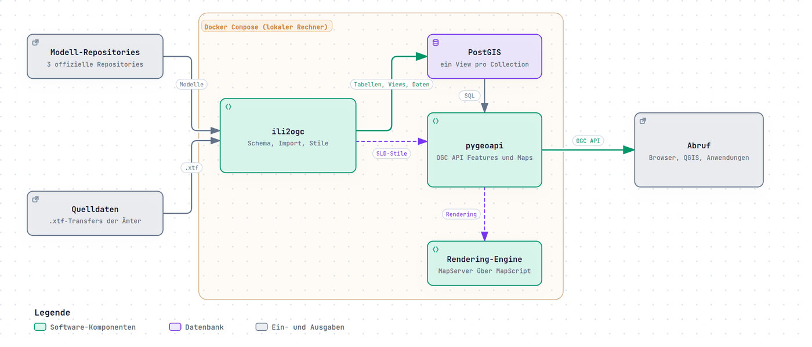
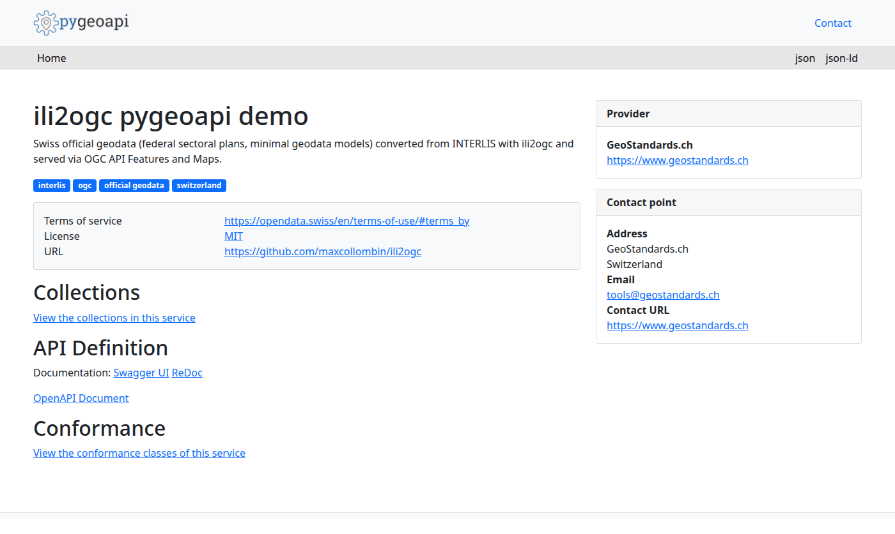
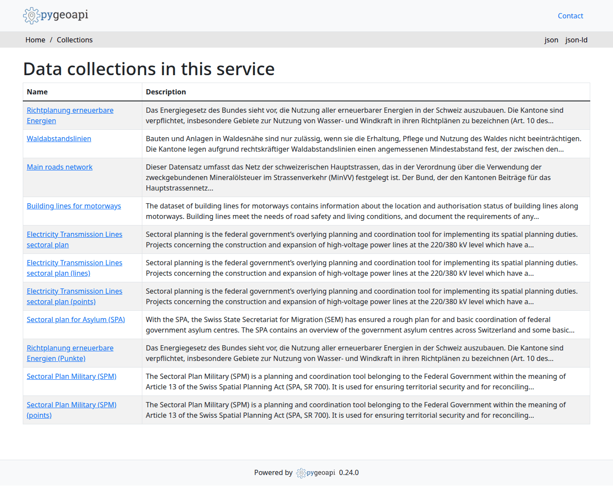

# Erste Schritte

## Voraussetzungen

Docker mit Docker Compose und ein Internetzugang: Die offiziellen INTERLIS-Modelle, die von den Datensätzen importiert werden, werden beim Laden aus den Modell-Repositories heruntergeladen; sie sind nicht im Repository versioniert.

## Den Stack starten

```bash
git clone https://github.com/geostandards-ch/ili2ogc-pygeoapi-demo.git
cd ili2ogc-pygeoapi-demo
docker compose up --build
```

Drei Dienste starten in dieser Reihenfolge:

1. `postgis`: PostGIS-Datenbank, auf Port 5432 des lokalen Rechners veröffentlicht;
2. `loader`: pro Datensatz Herunterladen der Modelle, Validierung der Transferdatei, Erstellen des Schemas, Import der Objekte, Schreiben der SLD-Stile, danach Beenden;
3. `pygeoapi`: startet, sobald der Loader erfolgreich beendet ist, Port 5000.

<figure markdown>
  { width="800" }
  <figcaption>Architektur des Docker-Compose-Stacks: ili2ogc füllt PostGIS, pygeoapi veröffentlicht die Daten und lässt die Karten von MapServer zeichnen.</figcaption>
</figure>

Das Laden ist der lange Teil des ersten Starts. Die API antwortet nicht, solange der Loader nicht fertig ist: Die Logs von `loader` zeigen den Fortschritt (Befehle `interlis fetch-models`, `validate-xtf`, `convert-sql`, `import-xtf`, `convert-sld`).

## Adressen

| Adresse | Inhalt |
|---|---|
| <http://localhost:5000> | Startseite der API |
| <http://localhost:5000/collections> | Liste der Collections |
| <http://localhost:5000/openapi> | OpenAPI-Definition |
| `localhost:5432` | PostGIS (Datenbank `postgres`, Benutzer `postgres`, Passwort `postgres`, ein Schema pro Collection) |

Die PostGIS-Zugangsdaten stammen aus der Datei `docker-compose.yml` und sind nur für den lokalen Gebrauch bestimmt.

<figure markdown>
  { width="700" }
  <figcaption>Startseite der API, nach Abschluss des Ladens.</figcaption>
</figure>

<figure markdown>
  { width="700" }
  <figcaption>Liste der Collections (`/collections`).</figcaption>
</figure>

## Stoppen und neu starten

```bash
docker compose down          # stoppt den Stack
docker compose up            # startet neu, ohne die Images neu zu bauen
docker compose down -v       # löscht auch das Volume mit den Stilen
```

Der Loader erstellt bei jedem Start jedes Schema neu (`DROP SCHEMA ... CASCADE`).

## Daten

| Collections | Datensatz | Anbieter |
|---|---|---|
| `richtplanung`, `richtplanung_punkte` | Richtplanung erneuerbare Energien (Kanton Schaffhausen) | KGK-CGC, geodienste.ch |
| `waldabstandslinien` | Waldabstandslinien (Kanton Glarus) | KGK-CGC, geodienste.ch |
| `mainroads` | Hauptstrassennetz | ASTRA |
| `buildinglines` | Baulinien der Nationalstrassen (Auszug) | ASTRA |
| `uebertragungsleitungen`, `_linien`, `_punkte` | Sachplan Übertragungsleitungen | BFE |
| `asyl` | Sachplan Asyl | SEM |
| `militaer`, `militaer_punkte` | Sachplan Militär | VBS |

Jede Collection enthält nur einen Geometrietyp, da pygeoapi pro Collection nur einen zulässt: Ein Datensatz ergibt daher mehrere Collections (Flächen, Linien, Punkte).
