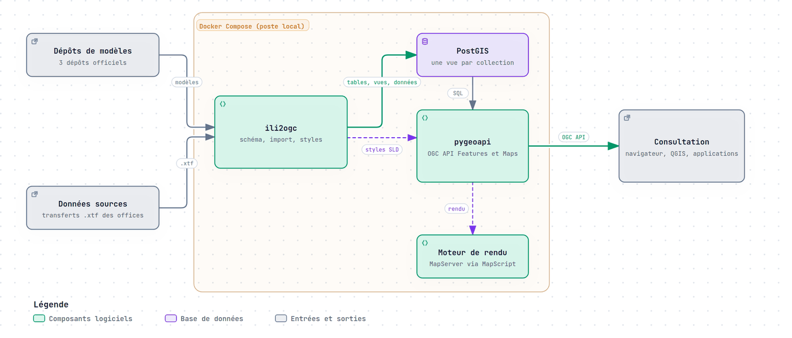
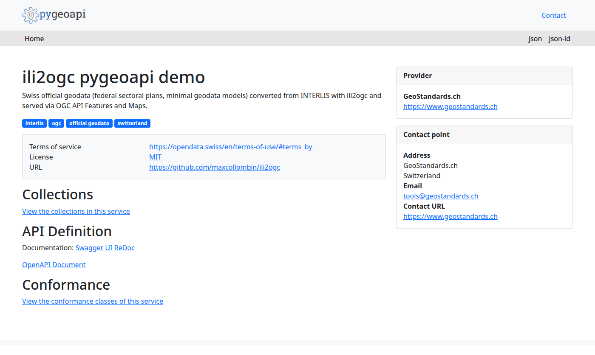
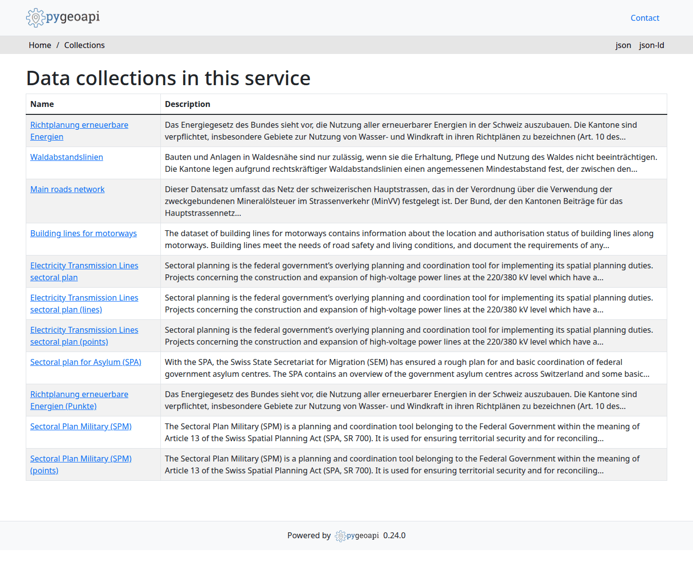

# Démarrer

## Prérequis

Docker avec Docker Compose et un accès à Internet : les modèles INTERLIS officiels importés par les jeux de données sont téléchargés au chargement depuis les dépôts de modèles, ils ne sont pas versionnés dans le dépôt.

## Lancer la pile

```bash
git clone https://github.com/geostandards-ch/ili2ogc-pygeoapi-demo.git
cd ili2ogc-pygeoapi-demo
docker compose up --build
```

Trois services démarrent dans cet ordre :

1. `postgis` : base PostGIS, publiée sur le port 5432 de la machine locale ;
2. `loader` : pour chaque jeu de données, téléchargement des modèles, validation du transfert, création du schéma, import des objets, écriture des styles SLD, puis arrêt ;
3. `pygeoapi` : démarre une fois le chargeur terminé avec succès, port 5000.

<figure markdown>
  { width="800" }
  <figcaption>Architecture de la pile Docker Compose : ili2ogc alimente PostGIS, pygeoapi publie et fait dessiner les cartes par MapServer.</figcaption>
</figure>

Le chargement est la partie longue du premier démarrage. L'API ne répond pas tant que le chargeur n'a pas terminé : les journaux de `loader` indiquent la progression (commandes `interlis fetch-models`, `validate-xtf`, `convert-sql`, `import-xtf`, `convert-sld`).

## Adresses

| Adresse | Contenu |
|---|---|
| <http://localhost:5000> | Page d'accueil de l'API |
| <http://localhost:5000/collections> | Liste des collections |
| <http://localhost:5000/openapi> | Définition OpenAPI |
| `localhost:5432` | PostGIS (base `postgres`, utilisateur `postgres`, mot de passe `postgres`, un schéma par collection) |

Les identifiants PostGIS sont ceux du fichier `docker-compose.yml`, réservés à un usage local.

<figure markdown>
  { width="700" }
  <figcaption>Page d'accueil de l'API, une fois le chargement terminé.</figcaption>
</figure>

<figure markdown>
  { width="700" }
  <figcaption>Liste des collections (`/collections`).</figcaption>
</figure>


## Arrêter et relancer

```bash
docker compose down          # arrête la pile
docker compose up            # relance, sans reconstruire les images
docker compose down -v       # supprime aussi le volume des styles
```

Le chargeur recrée chaque schéma à chaque démarrage (`DROP SCHEMA ... CASCADE`).

## Données

| Collections | Jeu de données | Fournisseur |
|---|---|---|
| `richtplanung`, `richtplanung_punkte` | Plan directeur, énergies renouvelables (canton de Schaffhouse) | KGK-CGC, geodienste.ch |
| `waldabstandslinien` | Distances par rapport à la forêt (canton de Glaris) | KGK-CGC, geodienste.ch |
| `mainroads` | Réseau des routes principales | OFROU |
| `buildinglines` | Alignements de construction des routes nationales (extrait) | OFROU |
| `uebertragungsleitungen`, `_linien`, `_punkte` | Plan sectoriel des lignes de transport d'électricité | OFEN |
| `asyl` | Plan sectoriel de l'asile | SEM |
| `militaer`, `militaer_punkte` | Plan sectoriel militaire | DDPS |

Chaque collection ne contient qu'un type de géométrie, car pygeoapi n'en admet qu'un par collection : un même jeu de données donne donc plusieurs collections (surfaces, lignes, points).
