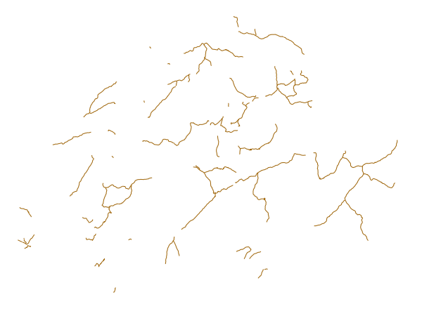
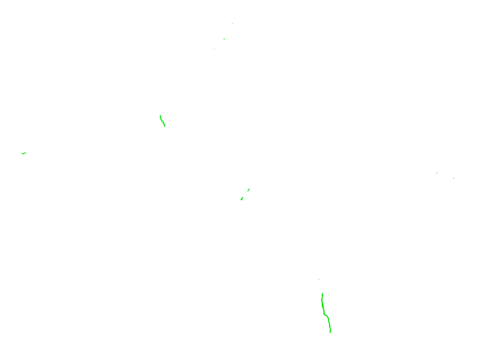

# Beispielantworten der API

Diese Seite zeigt, was der Demonstrator antwortet, ohne dass ein Server läuft: Die untenstehenden Dateien wurden von `scripts/snapshot.py` aus einem laufenden Stack aufgezeichnet. Die Links innerhalb der Dateien verweisen auf `http://localhost:5000`, die Adresse des lokalen Stacks.

Für jede Collection:

- `collection.json`: die Beschreibung der Collection (Ausdehnung, Links, Formate);
- `schema.json`: das Schema der Eigenschaften, wie es Teil 5 von OGC API - Features bedient;
- `queryables.json`: die filterbaren Eigenschaften;
- `items.json` und `items.jsonfg.json`: fünf Objekte als GeoJSON und als JSON-FG;
- `map.png`: die von MapServer mit dem aus dem Darstellungsmodell erzeugten Stil gezeichnete Karte (sofern die Collection eine hat).

| Collection | Beschreibung | Objekte (GeoJSON) | Objekte (JSON-FG) | Schema | Karte |
|---|---|---|---|---|---|
| richtplanung | Richtplanung erneuerbare Energien | [items](snapshot/richtplanung/items.json) | [items](snapshot/richtplanung/items.jsonfg.json) | [Schema](snapshot/richtplanung/schema.json) |  |
| waldabstandslinien | Waldabstandslinien | [items](snapshot/waldabstandslinien/items.json) | [items](snapshot/waldabstandslinien/items.jsonfg.json) | [Schema](snapshot/waldabstandslinien/schema.json) |  |
| mainroads | Hauptstrassen | [items](snapshot/mainroads/items.json) | [items](snapshot/mainroads/items.jsonfg.json) | [Schema](snapshot/mainroads/schema.json) |  |
| buildinglines | Baulinien | [items](snapshot/buildinglines/items.json) | [items](snapshot/buildinglines/items.jsonfg.json) | [Schema](snapshot/buildinglines/schema.json) |  |
| uebertragungsleitungen | Übertragungsleitungen | [items](snapshot/uebertragungsleitungen/items.json) | [items](snapshot/uebertragungsleitungen/items.jsonfg.json) | [Schema](snapshot/uebertragungsleitungen/schema.json) |  |
| asyl | Sachplan Asyl | [items](snapshot/asyl/items.json) | [items](snapshot/asyl/items.jsonfg.json) | [Schema](snapshot/asyl/schema.json) |  |
| militaer | Sachplan Militär | [items](snapshot/militaer/items.json) | [items](snapshot/militaer/items.jsonfg.json) | [Schema](snapshot/militaer/schema.json) |  |

Die abgeleiteten Collections (`*_punkte`, `*_linien`) haben ihre Dateien im selben Ordner, ohne Karte.
