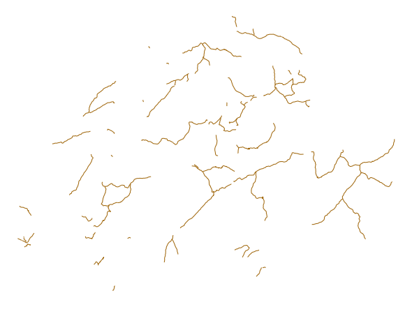
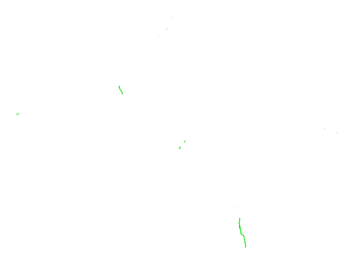

# Exemples de réponses de l'API

Cette page montre ce que le démonstrateur répond, sans qu'aucun serveur ne soit lancé : les fichiers ci-dessous ont été
enregistrés d'une pile en marche par `scripts/snapshot.py`. Les liens à l'intérieur des fichiers pointent vers
`http://localhost:5000`, l'adresse de la pile locale.

Pour chaque collection :

- `collection.json` : la description de la collection (étendue, liens, formats) ;
- `schema.json` : le schéma des propriétés servi par la partie 5 d'OGC API - Features ;
- `queryables.json` : les propriétés filtrables ;
- `items.json` et `items.jsonfg.json` : cinq objets en GeoJSON et en JSON-FG ;
- `map.png` : la carte dessinée par MapServer avec le style généré depuis le modèle graphique (quand la collection en a une).

| Collection | Description | Objets (GeoJSON) | Objets (JSON-FG) | Schéma | Carte |
|---|---|---|---|---|---|
| richtplanung | Plan directeur, énergies renouvelables | [items](snapshot/richtplanung/items.json) | [items](snapshot/richtplanung/items.jsonfg.json) | [schéma](snapshot/richtplanung/schema.json) |  |
| waldabstandslinien | Lignes de distance à la forêt | [items](snapshot/waldabstandslinien/items.json) | [items](snapshot/waldabstandslinien/items.jsonfg.json) | [schéma](snapshot/waldabstandslinien/schema.json) |  |
| mainroads | Routes principales | [items](snapshot/mainroads/items.json) | [items](snapshot/mainroads/items.jsonfg.json) | [schéma](snapshot/mainroads/schema.json) |  |
| buildinglines | Alignements | [items](snapshot/buildinglines/items.json) | [items](snapshot/buildinglines/items.jsonfg.json) | [schéma](snapshot/buildinglines/schema.json) |  |
| uebertragungsleitungen | Lignes de transport d'électricité | [items](snapshot/uebertragungsleitungen/items.json) | [items](snapshot/uebertragungsleitungen/items.jsonfg.json) | [schéma](snapshot/uebertragungsleitungen/schema.json) |  |
| asyl | Plan sectoriel asile | [items](snapshot/asyl/items.json) | [items](snapshot/asyl/items.jsonfg.json) | [schéma](snapshot/asyl/schema.json) |  |
| militaer | Plan sectoriel militaire | [items](snapshot/militaer/items.json) | [items](snapshot/militaer/items.jsonfg.json) | [schéma](snapshot/militaer/schema.json) |  |

Les collections dérivées (`*_punkte`, `*_linien`) ont leurs fichiers dans le même dossier, sans carte.
