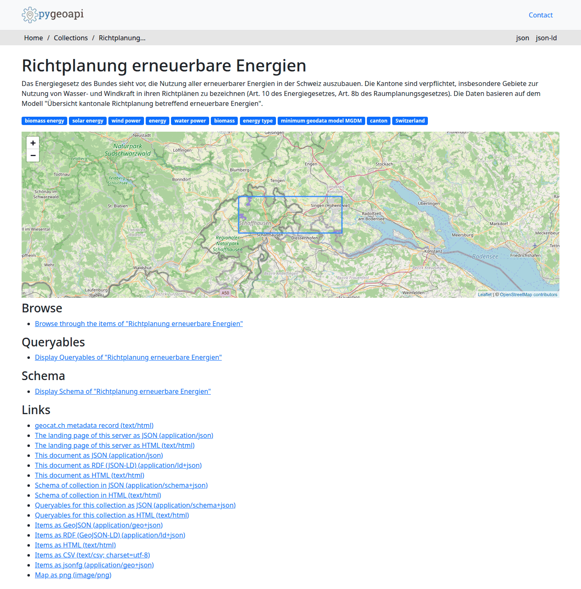
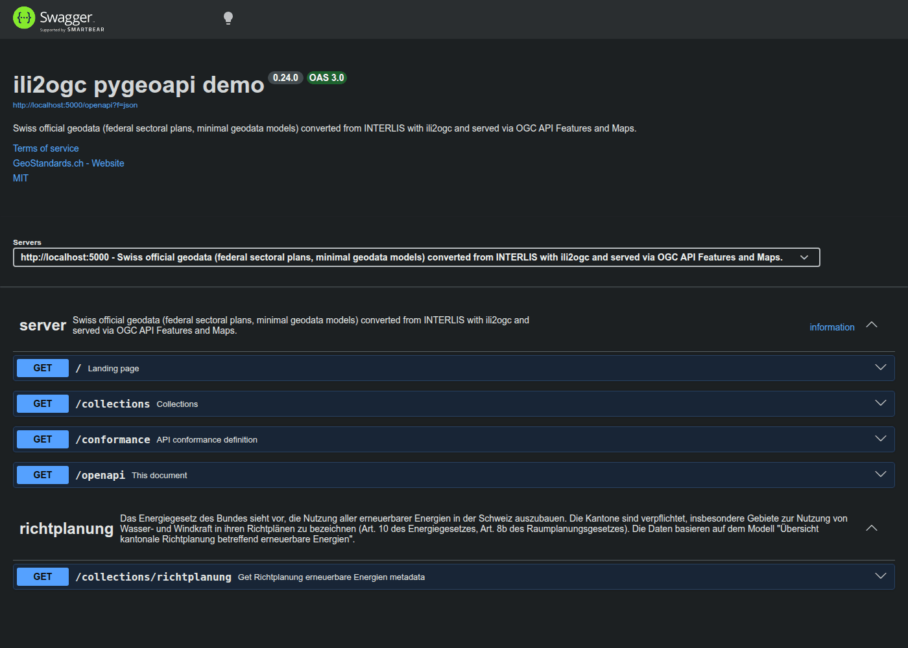
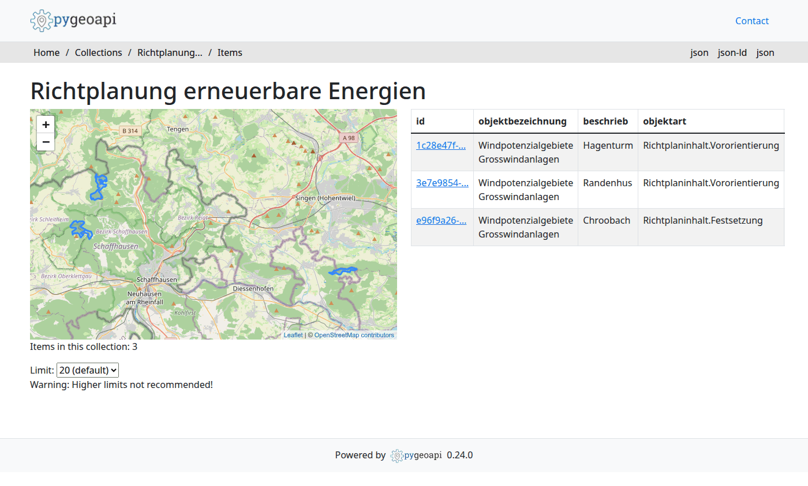
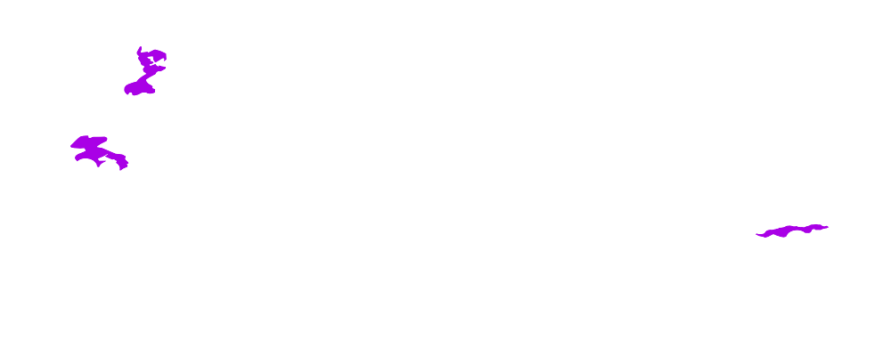
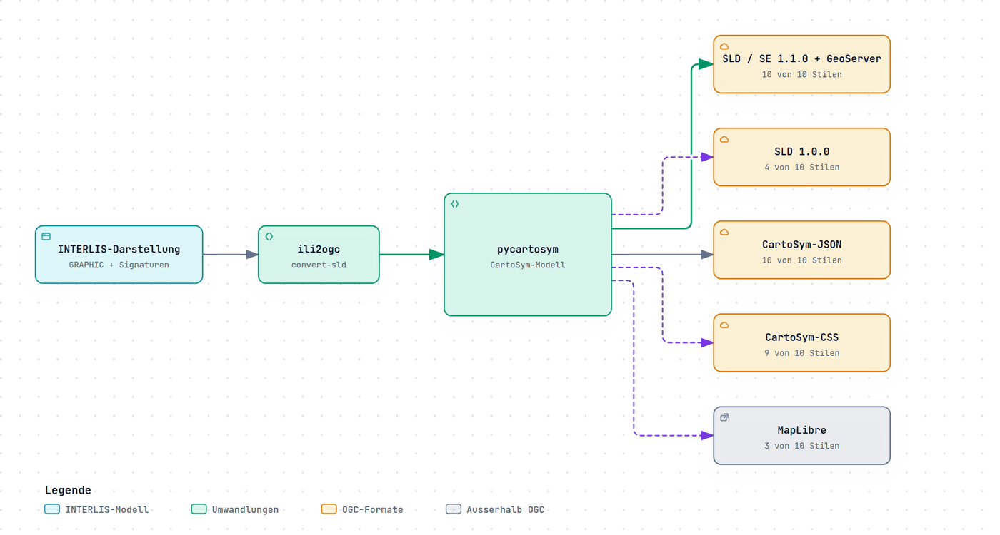
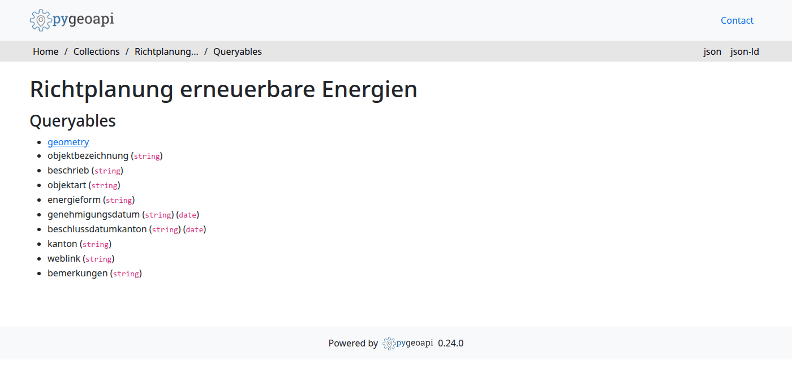

# Die Demo erkunden

Die untenstehenden Links verweisen auf die lokale Instanz (<http://localhost:5000>, siehe [Erste Schritte](demarrer.md)). Als Beispiele dienen durchgehend `waldabstandslinien` (Linien) und `richtplanung` (Flächen).

## Startseite und Collections

| Ressource | Link |
|---|---|
| Startseite | <http://localhost:5000> |
| Startseite als JSON | <http://localhost:5000/?f=json> |
| Konformität (implementierte OGC-Klassen) | <http://localhost:5000/conformance?f=json> |
| Collections | <http://localhost:5000/collections> |
| Eine Collection | <http://localhost:5000/collections/waldabstandslinien> |
| OpenAPI-Definition | <http://localhost:5000/openapi> |

Jede Collection gibt ihre Ausdehnung, ihre Koordinatenreferenzsysteme (`crs`, mit `storageCrs` EPSG:2056) und Links zu ihren Objekten, ihrem Schema, ihren Queryables, ihrer Karte und ihrem Metadatensatz auf geocat.ch an.

<figure markdown>
  { width="700" }
  <figcaption>Seite einer Collection: Beschreibung, Ausdehnung auf einer Karte, dann Links zu den Objekten, zum Schema und zu den Queryables.</figcaption>
</figure>

<figure markdown>
  { width="700" }
  <figcaption>OpenAPI-Definition der Demo (`/openapi`), dargestellt mit Swagger.</figcaption>
</figure>

## Objekte: HTML, GeoJSON, JSON-FG

Der Parameter `f` wählt das Format.

| Format | Link |
|---|---|
| HTML (Karte und Tabelle) | <http://localhost:5000/collections/waldabstandslinien/items?f=html> |
| GeoJSON | <http://localhost:5000/collections/waldabstandslinien/items?f=json&limit=1> |
| JSON-FG | <http://localhost:5000/collections/richtplanung/items?f=jsonfg&limit=1> |
| CSV | <http://localhost:5000/collections/waldabstandslinien/items?f=csv> |

<figure markdown>
  { width="700" }
  <figcaption>Die Objekte von `richtplanung` in HTML: Leaflet-Karte und Attributtabelle.</figcaption>
</figure>

Erwartete Antwort in GeoJSON (Auszug, `limit=1`):

```json
{
  "type": "FeatureCollection",
  "features": [
    {
      "type": "Feature",
      "id": "186",
      "properties": {
        "t_ili_tid": "186",
        "publiziertab": "2011-01-01",
        "publiziertbis": null,
        "rechtsstatus": "inKraft",
        "bemerkungen": null,
        "typ_code": "x",
        "typ_bezeichnung": "Waldabstandslinie",
        "typ_abkuerzung": null,
        "typ_verbindlichkeit": "Nutzungsplanfestlegung"
      },
      "geometry": { "type": "LineString", "coordinates": [[9.0544, 47.1145], "..."] }
    }
  ],
  "numberReturned": 1
}
```

Die Feldnamen sind die der INTERLIS-VIEW des Datensatzes (`collections/waldabstandslinien/views.ili`). `t_ili_tid` ist der Identifikator des Objekts in der INTERLIS-Transferdatei. Die Referenzen des Modells werden zu Attributen des referenzierten Objekts aufgelöst (hier `typ_*`).

### JSON-FG

Die JSON-FG-Antwort ergänzt `coordRefSys`, `conformsTo`, `featureSchema` und pro Objekt `geometry` (WGS 84) und `place` (angefordertes System):

- ohne `crs` oder mit `crs=http://www.opengis.net/def/crs/OGC/1.3/CRS84` enthält die Antwort kein `place`;
- mit einem anderen `crs` enthält `place` die Geometrie in diesem System:
  <http://localhost:5000/collections/waldabstandslinien/items?f=jsonfg&limit=1&crs=http://www.opengis.net/def/crs/EPSG/0/2056>

Der Medientyp ist `application/geo+json`, und `featureType` trägt den Namen der INTERLIS-VIEW der Collection (hier `linien`), im Dokument und bei jedem Objekt.

## Nützliche Parameter

| Parameter | Zweck | Beispiel |
|---|---|---|
| `limit`, `offset` | Seitenweise Ausgabe (standardmässig 20 Objekte, höchstens 500) | [`limit=5&offset=5`](http://localhost:5000/collections/waldabstandslinien/items?f=json&limit=5&offset=5) |
| `bbox` | Ausschnitt `minx,miny,maxx,maxy`, standardmässig in Grad (CRS84) | [`bbox=9.04,47.09,9.19,47.12`](http://localhost:5000/collections/waldabstandslinien/items?f=json&bbox=9.04,47.09,9.19,47.12) |
| `bbox-crs` | Koordinatensystem von `bbox` | siehe unten |
| `crs` | Koordinatensystem der Antwort | [`crs=http://www.opengis.net/def/crs/EPSG/0/2056`](http://localhost:5000/collections/waldabstandslinien/items?f=json&limit=1&crs=http://www.opengis.net/def/crs/EPSG/0/2056) |
| `f` | Format: `json`, `jsonfg`, `html`, `csv`, `jsonld` | |

Für `crs` und `bbox-crs` angebotene Systeme: EPSG:2056 (LV95, Speichersystem) und CRS84.

### `bbox` in Schweizer Koordinaten

Ein Ausschnitt in EPSG:2056 muss von `bbox-crs` begleitet sein, sonst werden seine Werte als Grad gelesen.

| Abfrage | Ergebnis |
|---|---|
| [`bbox=2720000,1215000,2730000,1220000`](http://localhost:5000/collections/waldabstandslinien/items?f=json&limit=1&bbox=2720000,1215000,2730000,1220000) | kein Objekt (`numberMatched` ist 0) |
| [`bbox=2720000,1215000,2730000,1220000&bbox-crs=http://www.opengis.net/def/crs/EPSG/0/2056`](http://localhost:5000/collections/waldabstandslinien/items?f=json&limit=1&bbox=2720000,1215000,2730000,1220000&bbox-crs=http://www.opengis.net/def/crs/EPSG/0/2056) | die Objekte im Ausschnitt |

## OGC API - Maps

Jede Collection (ausser den Punkten der Übertragungsleitungen) hat eine Karte unter `/collections/{id}/map`, gezeichnet mit dem SLD-Stil, der aus der INTERLIS-Darstellung erzeugt wird.

| Karte | Link |
|---|---|
| Waldabstandslinien, Ausschnitt in Grad | <http://localhost:5000/collections/waldabstandslinien/map?f=png&bbox=9.04,47.09,9.19,47.12> |
| Dieselbe Karte, Ausschnitt in LV95 | <http://localhost:5000/collections/waldabstandslinien/map?f=png&bbox=2720000,1215000,2730000,1220000&bbox-crs=http://www.opengis.net/def/crs/EPSG/0/2056> |
| Richtplanung, gewählte Grösse | <http://localhost:5000/collections/richtplanung/map?f=png&bbox=8.5,47.65,8.9,47.8&width=800&height=400> |

Die Antwort ist ein PNG-Bild. Für `bbox` und `bbox-crs` gelten dieselben Regeln wie für die Objekte. Eine Karte ohne `bbox` ist leer: Ein Ausschnitt, der die ganze Schweiz abdeckt, reduziert die Objekte auf weniger als ein Pixel.

<figure markdown>
  { width="700" }
  <figcaption>OGC-API-Maps-Karte von `richtplanung` (`/map?f=png`), gezeichnet mit dem SLD-Stil aus der INTERLIS-Darstellung.</figcaption>
</figure>

<figure markdown>
  { width="800" }
  <figcaption>Woher der Stil kommt: Die INTERLIS-Darstellung wird in SLD umgewandelt, das MapServer anwendet.</figcaption>
</figure>

## Queryables und Schema

| Ressource | Link |
|---|---|
| Queryables (filterbare Eigenschaften) | <http://localhost:5000/collections/waldabstandslinien/queryables?f=json> |
| Schema der Objekte | <http://localhost:5000/collections/waldabstandslinien/schema?f=json> |

<figure markdown>
  { width="600" }
  <figcaption>Queryables von `richtplanung` (`/queryables`): ein Attribut pro Zeile, mit seinem Typ.</figcaption>
</figure>

Beide Antworten haben den Typ `application/schema+json`: ein JSON Schema, das die Geometrie (`x-ogc-role: primary-geometry`) und jedes Attribut mit seinem Typ (`string`, `date`, ...) auflistet.
