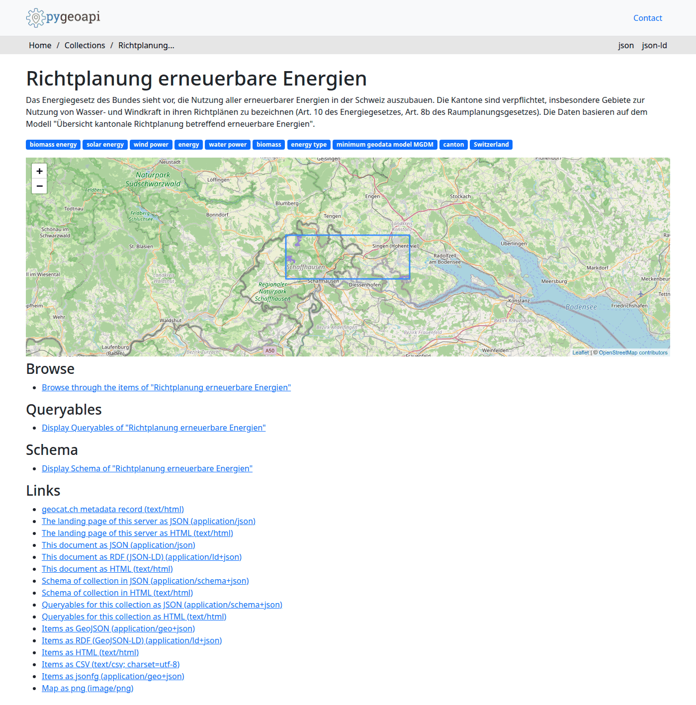
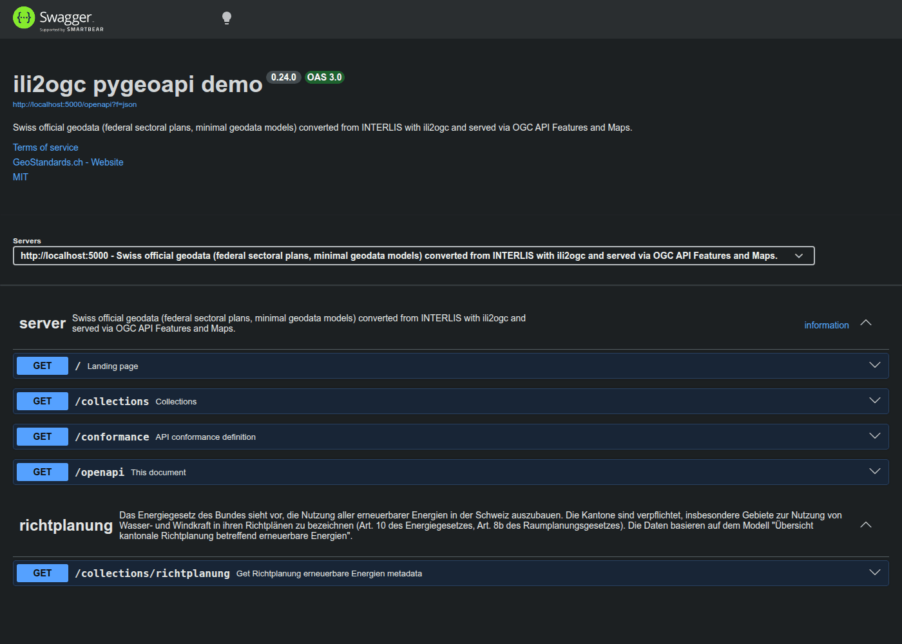
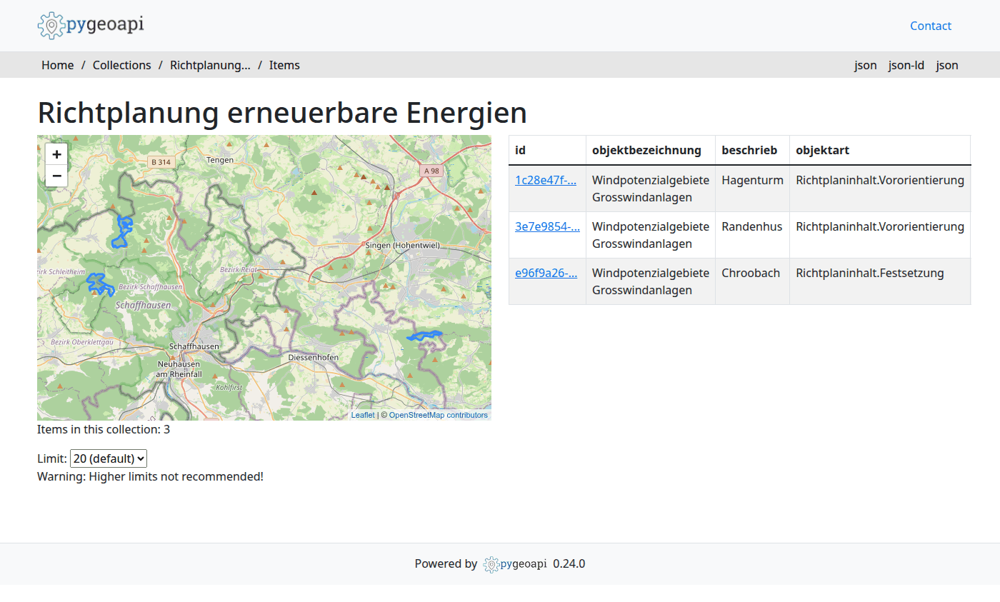
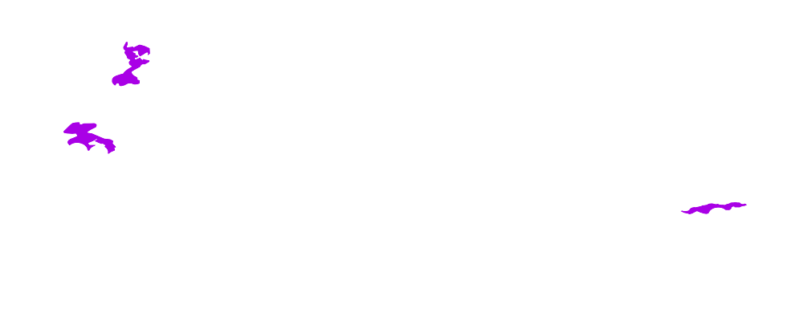
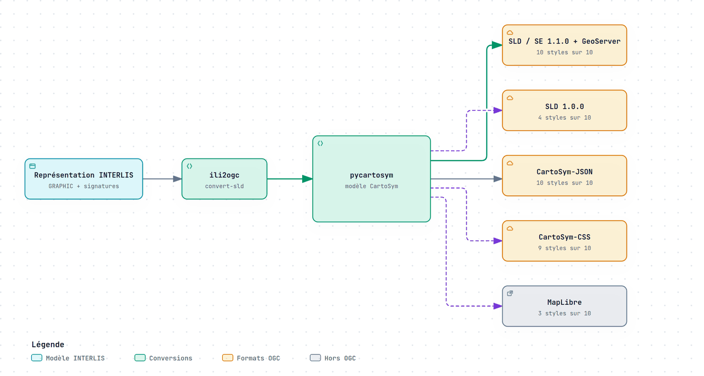
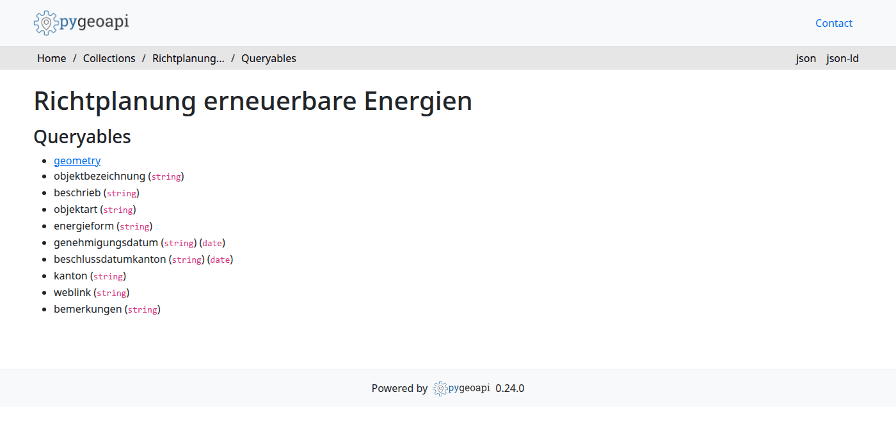

# Explorer la démo

Les liens ci-dessous visent l'instance locale (<http://localhost:5000>, voir [Démarrer](demarrer.md)). Dans cette page, `waldabstandslinien` (lignes) et `richtplanung` (surfaces) servent d'exemples.

## Page d'accueil et collections

| Ressource | Lien |
|---|---|
| Page d'accueil | <http://localhost:5000> |
| Page d'accueil en JSON | <http://localhost:5000/?f=json> |
| Conformité (classes OGC implémentées) | <http://localhost:5000/conformance?f=json> |
| Collections | <http://localhost:5000/collections> |
| Une collection | <http://localhost:5000/collections/waldabstandslinien> |
| Définition OpenAPI | <http://localhost:5000/openapi> |

Chaque collection indique son étendue, ses systèmes de coordonnées (`crs`, avec `storageCrs` EPSG:2056) et des liens vers ses objets, son schéma, ses queryables, sa carte et sa fiche de métadonnées sur geocat.ch.

<figure markdown>
  { width="700" }
  <figcaption>Page d'une collection : description, étendue sur une carte, puis liens vers les objets, le schéma et les queryables.</figcaption>
</figure>

<figure markdown>
  { width="700" }
  <figcaption>Définition OpenAPI de la démo (`/openapi`), rendue par Swagger.</figcaption>
</figure>


## Objets : HTML, GeoJSON, JSON-FG

Le paramètre `f` choisit le format.

| Format | Lien |
|---|---|
| HTML (carte et tableau) | <http://localhost:5000/collections/waldabstandslinien/items?f=html> |
| GeoJSON | <http://localhost:5000/collections/waldabstandslinien/items?f=json&limit=1> |
| JSON-FG | <http://localhost:5000/collections/richtplanung/items?f=jsonfg&limit=1> |
| CSV | <http://localhost:5000/collections/waldabstandslinien/items?f=csv> |

<figure markdown>
  { width="700" }
  <figcaption>Les objets de `richtplanung` en HTML : carte Leaflet et tableau des attributs.</figcaption>
</figure>

Réponse attendue en GeoJSON (extrait, `limit=1`) :

```json
{
  "type": "FeatureCollection",
  "features": [
    {
      "type": "Feature",
      "id": "186",
      "properties": {
        "t_ili_tid": "186",
        "publiziertab": "2011-01-01",
        "publiziertbis": null,
        "rechtsstatus": "inKraft",
        "bemerkungen": null,
        "typ_code": "x",
        "typ_bezeichnung": "Waldabstandslinie",
        "typ_abkuerzung": null,
        "typ_verbindlichkeit": "Nutzungsplanfestlegung"
      },
      "geometry": { "type": "LineString", "coordinates": [[9.0544, 47.1145], "..."] }
    }
  ],
  "numberReturned": 1
}
```

Les noms de champs sont ceux des VIEW INTERLIS du jeu de données (`collections/waldabstandslinien/views.ili`). `t_ili_tid` est l'identifiant de l'objet dans le transfert INTERLIS. Les références du modèle sont résolues en attributs de l'objet référencé (ici `typ_*`).

### JSON-FG

La réponse JSON-FG ajoute `coordRefSys`, `conformsTo`, `featureSchema` et, par objet, `geometry` (WGS 84) et `place` (système demandé) :

- sans `crs`, ou avec `crs=http://www.opengis.net/def/crs/OGC/1.3/CRS84`, la réponse n'a pas de `place` ;
- avec un autre `crs`, `place` porte la géométrie dans ce système :
  <http://localhost:5000/collections/waldabstandslinien/items?f=jsonfg&limit=1&crs=http://www.opengis.net/def/crs/EPSG/0/2056>

Le type de média est `application/geo+json` et `featureType` porte le nom de la VIEW INTERLIS de la collection (ici `linien`), sur le document et sur chaque objet.

## Paramètres utiles

| Paramètre | Rôle | Exemple |
|---|---|---|
| `limit`, `offset` | Pagination (20 objets par défaut, 500 au plus) | [`limit=5&offset=5`](http://localhost:5000/collections/waldabstandslinien/items?f=json&limit=5&offset=5) |
| `bbox` | Emprise `minx,miny,maxx,maxy`, en degrés (CRS84) par défaut | [`bbox=9.04,47.09,9.19,47.12`](http://localhost:5000/collections/waldabstandslinien/items?f=json&bbox=9.04,47.09,9.19,47.12) |
| `bbox-crs` | Système de coordonnées de `bbox` | voir ci-dessous |
| `crs` | Système de coordonnées de la réponse | [`crs=http://www.opengis.net/def/crs/EPSG/0/2056`](http://localhost:5000/collections/waldabstandslinien/items?f=json&limit=1&crs=http://www.opengis.net/def/crs/EPSG/0/2056) |
| `f` | Format : `json`, `jsonfg`, `html`, `csv`, `jsonld` | |

Systèmes proposés pour `crs` et `bbox-crs` : EPSG:2056 (LV95, système de stockage) et CRS84.

### `bbox` en coordonnées suisses

Une emprise en EPSG:2056 doit être accompagnée de `bbox-crs`, sinon ses valeurs sont lues en degrés.

| Requête | Résultat |
|---|---|
| [`bbox=2720000,1215000,2730000,1220000`](http://localhost:5000/collections/waldabstandslinien/items?f=json&limit=1&bbox=2720000,1215000,2730000,1220000) | aucun objet (`numberMatched` à 0) |
| [`bbox=2720000,1215000,2730000,1220000&bbox-crs=http://www.opengis.net/def/crs/EPSG/0/2056`](http://localhost:5000/collections/waldabstandslinien/items?f=json&limit=1&bbox=2720000,1215000,2730000,1220000&bbox-crs=http://www.opengis.net/def/crs/EPSG/0/2056) | les objets de l'emprise |

## OGC API - Maps

Chaque collection (sauf les points des lignes de transport d'électricité) a une carte à l'adresse `/collections/{id}/map`, dessinée avec le style SLD produit à partir de la symbologie INTERLIS.

| Carte | Lien |
|---|---|
| Waldabstandslinien, emprise en degrés | <http://localhost:5000/collections/waldabstandslinien/map?f=png&bbox=9.04,47.09,9.19,47.12> |
| Même carte, emprise en LV95 | <http://localhost:5000/collections/waldabstandslinien/map?f=png&bbox=2720000,1215000,2730000,1220000&bbox-crs=http://www.opengis.net/def/crs/EPSG/0/2056> |
| Richtplanung, taille choisie | <http://localhost:5000/collections/richtplanung/map?f=png&bbox=8.5,47.65,8.9,47.8&width=800&height=400> |

La réponse est une image PNG. Les règles de `bbox` et `bbox-crs` sont les mêmes que pour les objets. Une carte demandée sans `bbox` est vide : une emprise couvrant toute la Suisse réduit les objets à moins d'un pixel.

<figure markdown>
  { width="700" }
  <figcaption>Carte OGC API - Maps de `richtplanung` (`/map?f=png`), dessinée avec le style SLD issu de la symbologie INTERLIS.</figcaption>
</figure>

<figure markdown>
  { width="800" }
  <figcaption>D'où vient le style : la représentation INTERLIS est convertie en SLD, que MapServer applique.</figcaption>
</figure>


## Queryables et schéma

| Ressource | Lien |
|---|---|
| Queryables (propriétés filtrables) | <http://localhost:5000/collections/waldabstandslinien/queryables?f=json> |
| Schéma des objets | <http://localhost:5000/collections/waldabstandslinien/schema?f=json> |

<figure markdown>
  { width="600" }
  <figcaption>Queryables de `richtplanung` (`/queryables`) : un attribut par ligne, avec son type.</figcaption>
</figure>

Les deux réponses ont le type `application/schema+json` : un JSON Schema listant la géométrie (`x-ogc-role: primary-geometry`) et chaque attribut avec son type (`string`, `date`, ...).
