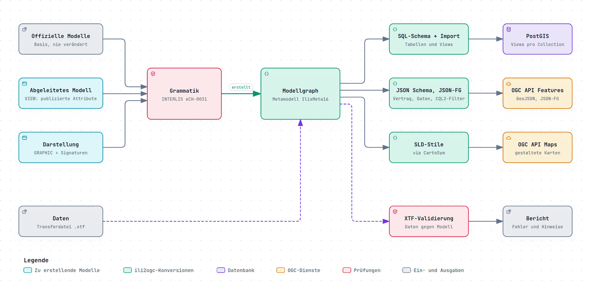

# ili2ogc-pygeoapi-Demonstrator

Der Demonstrator bedient reale Schweizer Geodaten (kantonale Daten, Nationalstrassen, Sachpläne des Bundes) **direkt aus ihren INTERLIS-Transferdateien**, ohne von Hand geschriebenes SQL.

- Der Loader [ili2ogc](https://github.com/geostandards-ch/ili2ogc) lädt die offiziellen Modelle herunter, validiert jede Transferdatei, erstellt das PostGIS-Schema (ein View pro INTERLIS-VIEW) und lädt die Objekte.
- Dasselbe Werkzeug schreibt für jedes `GRAPHIC` des INTERLIS-Darstellungsmodells einen SLD-Stil.
- [pygeoapi](https://pygeoapi.io) veröffentlicht die Daten als **OGC API - Features** (GeoJSON, JSON-FG, HTML, CSV) und die Karten als **OGC API - Maps**, gezeichnet mit diesen Stilen.
- Der Stack besteht aus drei Docker-Diensten: PostGIS, Loader und pygeoapi.
- Jeder Datensatz bildet ein Verzeichnis unter `collections/`: seine VIEW, seine Darstellung und seine Signaturen.
- Die Daten sind öffentlich (Open Data), unter Angabe der Quelle.

<figure markdown>
  { width="800" }
  <figcaption>Prinzip von ili2ogc: von den INTERLIS-Eingaben zu den OGC-Diensten.</figcaption>
</figure>

| Seite | Inhalt |
|---|---|
| [Erste Schritte](demarrer.md) | Den Stack starten, Adressen |
| [Die Demo erkunden](explorer.md) | Collections, Formate, Parameter, Karten, Schema |
| [QGIS Schritt für Schritt](qgis.md) | Die Demo und andere Dienste verbinden |
| [Vergleich](comparer.md) | Demo und veröffentlichte Dienste zum selben Thema |
| [Beispielantworten](exemples-reponses.md) | Aufgezeichnete Antworten der API, ohne den Stack zu starten |
| [Fehlerbehebung und Grenzen](limites.md) | Häufige Fehler, was die Demo nicht zeigt |

Repository: [geostandards-ch/ili2ogc-pygeoapi-demo](https://github.com/geostandards-ch/ili2ogc-pygeoapi-demo).
