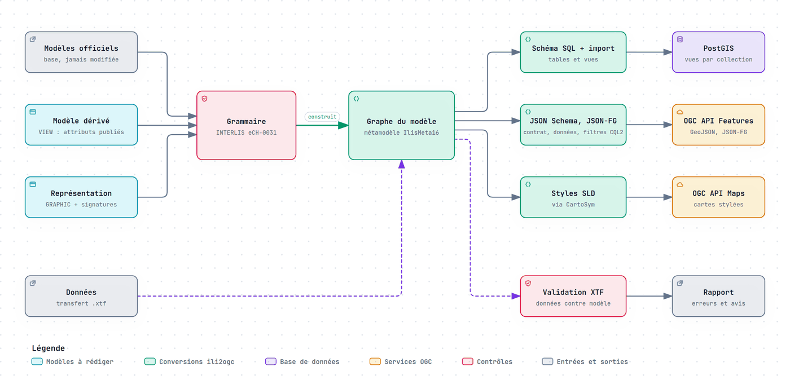

# Démonstrateur ili2ogc pygeoapi

Le démonstrateur sert des géodonnées suisses réelles (données cantonales, routes nationales, plans sectoriels fédéraux) **directement à partir de leurs transferts INTERLIS**, sans SQL écrit à la main.

- Le chargeur [ili2ogc](https://github.com/geostandards-ch/ili2ogc) télécharge les modèles officiels, valide chaque transfert, crée le schéma PostGIS (une vue par VIEW INTERLIS) et charge les objets.
- Le même outil écrit, pour chaque règle graphique du modèle de symbologie INTERLIS, un style SLD.
- [pygeoapi](https://pygeoapi.io) publie les données en **OGC API - Features** (GeoJSON, JSON-FG, HTML, CSV) et les cartes en **OGC API - Maps**, dessinées avec ces styles.
- La pile comprend trois services Docker : PostGIS, le chargeur et pygeoapi.
- Chaque jeu de données forme un répertoire sous `collections/` : ses VIEW, sa symbologie et ses signes.
- Les données sont publiques (open data), avec mention de la source.

<figure markdown>
  { width="800" }
  <figcaption>Principe d'ili2ogc : des entrées INTERLIS aux services OGC.</figcaption>
</figure>

| Page | Contenu |
|---|---|
| [Démarrer](demarrer.md) | Lancer la pile, adresses |
| [Explorer la démo](explorer.md) | Collections, formats, paramètres, cartes, schéma |
| [QGIS pas à pas](qgis.md) | Connecter la démo et d'autres services |
| [Comparer](comparer.md) | Démo et services publiés sur un même thème |
| [Exemples de réponses](exemples-reponses.md) | Réponses de l'API enregistrées, consultables sans lancer la pile |
| [Dépannage et limites](limites.md) | Erreurs courantes, ce que la démo ne montre pas |

Dépôt : [geostandards-ch/ili2ogc-pygeoapi-demo](https://github.com/geostandards-ch/ili2ogc-pygeoapi-demo).
