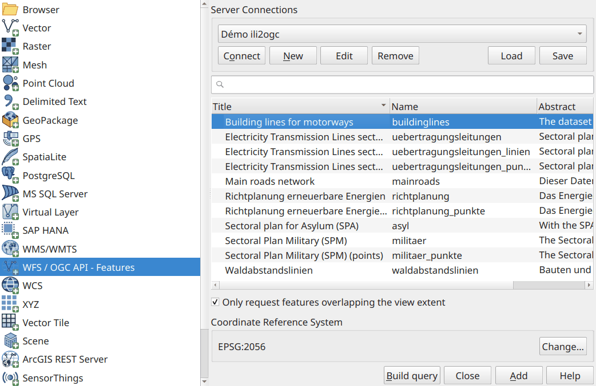
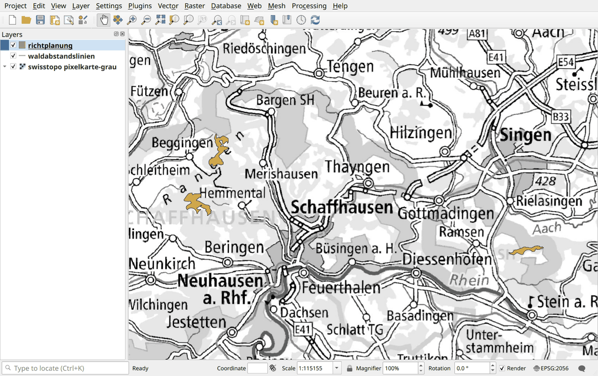

# QGIS Schritt für Schritt

Die Menüpfade folgen der Dokumentation von QGIS 3.44 ([docs.qgis.org](https://docs.qgis.org/3.44/de/docs/user_manual/working_with_ogc/ogc_client_support.html)). Die genauen Bezeichnungen können je nach Sprache und installierter Version leicht abweichen.

Vorab: Der Stack ist gestartet ([Erste Schritte](demarrer.md)), und das QGIS-Projekt verwendet EPSG:2056 (Statusleiste, unten rechts).

## 1. Die Demo als OGC API - Features verbinden

1. Menü **Layer > Layer hinzufügen > WFS- / OGC-API-Features-Layer hinzufügen** (Kurzbefehl: Datenquellenverwaltung, `Ctrl+L`, Reiter **WFS / OGC API - Features**).
2. **Neu** öffnet den Dialog «Neue WFS-Verbindung erstellen».
3. Name: `Démo ili2ogc`. URL: `http://localhost:5000` (für OGC API - Features ist die URL der Dienst-Startseite anzugeben).
4. In den WFS-Optionen die Version auf automatische Erkennung belassen (Schaltfläche **Erkennen**); Seitenweise Abfrage aktivieren und die Seitengrösse festlegen (zum Beispiel 100).
5. **OK**, dann **Verbinden**: Die Liste der Collections erscheint.
6. `waldabstandslinien` (und nach Wahl `richtplanung`) auswählen, dann **Hinzufügen**.

<figure markdown>
  { width="700" }
  <figcaption>QGIS 3.44: Verbindung zur Demo und Liste ihrer Collections (Aufnahme der Benutzeroberfläche, englische Oberfläche).</figcaption>
</figure>

Die Attribute des Layers sind die im Kapitel [Erkunden](explorer.md) beschriebenen (`typ_code`, `rechtsstatus`, ...). Die OGC-API-Maps-Karte (`/map`) lässt sich so nicht laden: Die Dokumentation von QGIS 3.44 erwähnt OGC API - Maps nicht, nur OGC API - Features. Um den INTERLIS-Stil zu sehen, die Adresse `/collections/{id}/map` im Browser öffnen.

## 2. Hintergrundkarten und Dienste von swisstopo hinzufügen

### WMTS: Hintergrundkarten

1. Menü **Layer > Layer hinzufügen > WMS/WMTS-Layer hinzufügen**.
2. Reiter **Layer**, **Neu**.
3. Name: `swisstopo WMTS LV95`. URL: `https://wmts.geo.admin.ch/EPSG/2056/1.0.0/WMTSCapabilities.xml`.
4. **OK**, **Verbinden**, zum Beispiel `ch.swisstopo.pixelkarte-grau` wählen, **Hinzufügen**.

Der Dienst ist öffentlich und braucht keinen Schlüssel. Die Capabilities-Datei gibt es auch für EPSG:3857 (`https://wmts.geo.admin.ch/EPSG/3857/1.0.0/WMTSCapabilities.xml`). Thematische Layer wie `ch.bfe.sachplan-uebertragungsleitungen_kraft` sind nicht in diesem WMTS enthalten: Sie befinden sich im WMS.

### WMS: thematische Layer

1. Im selben Dialog **Neu**.
2. Name: `geo.admin.ch WMS`. URL: `https://wms.geo.admin.ch/` (ohne `request=GetCapabilities`).
3. **Verbinden**, `ch.bfe.sachplan-uebertragungsleitungen_kraft` suchen (Sachplan Übertragungsleitungen, BFE), **Hinzufügen**.

Öffentlicher Dienst, ohne Schlüssel. Weitere nützliche Layer für den Vergleich: `ch.astra.hauptstrassennetz` (Hauptstrassen, zum Vergleich mit `mainroads`) und `ch.astra.baulinien-nationalstrassen` (Baulinien, zum Vergleich mit `buildinglines`).

Die Liste der Layer ist lang: Das Suchfeld des Dialogs filtert nach dem Namen.

## 3. geodienste.ch hinzufügen

geodienste.ch veröffentlicht die Geobasisdaten der Kantone in harmonisierter Form. Die Adressen haben die Form `https://geodienste.ch/db/{Thema}/{Sprache}` (Sprache: `deu`, `fra`, `ita`).

| Thema | Thema auf geodienste.ch | Layer |
|---|---|---|
| Waldabstandslinien | `npl_waldabstandslinien` | `waldabstandslinien` |
| Richtplanung erneuerbare Energien | `richtplanung_erneuerbare_energien` | `windenergie_flaechen`, `solarenergie_punkte`, ... |

### WMS

WMS/WMTS-Verbindung (derselbe Dialog wie oben):

- `https://geodienste.ch/db/npl_waldabstandslinien/deu`
- `https://geodienste.ch/db/richtplanung_erneuerbare_energien/deu`

Capabilities zur Überprüfung: [Waldabstandslinien](https://geodienste.ch/db/npl_waldabstandslinien/deu?SERVICE=WMS&VERSION=1.3.0&REQUEST=GetCapabilities), [Richtplanung](https://geodienste.ch/db/richtplanung_erneuerbare_energien/deu?SERVICE=WMS&VERSION=1.3.0&REQUEST=GetCapabilities).

### WFS

WFS-Verbindung (Reiter **WFS / OGC API - Features**), Version 2.0.0:

- `https://geodienste.ch/db/npl_waldabstandslinien/deu`
- `https://geodienste.ch/db/richtplanung_erneuerbare_energien/deu`

Objektarten: `waldabstandslinien`; `windenergie_flaechen`, `wasserkraft_linien` usw. (eine Objektart pro Energieform und Geometrie, dazu `*_metadaten`-Objektarten). Capabilities: [Waldabstandslinien](https://geodienste.ch/db/npl_waldabstandslinien/deu?SERVICE=WFS&VERSION=2.0.0&REQUEST=GetCapabilities), [Richtplanung](https://geodienste.ch/db/richtplanung_erneuerbare_energien/deu?SERVICE=WFS&VERSION=2.0.0&REQUEST=GetCapabilities). Ausgabeformate: GML 3.2, GML 3.1.1, GML 2.1.2 und GeoJSON.

### OGC API - Features

Dieselben Themen werden auch als OGC API - Features veröffentlicht. WFS- / OGC-API-Features-Verbindung, URL der Startseite:

- `https://geodienste.ch/db/npl_waldabstandslinien/deu/ogcapi`
- `https://geodienste.ch/db/richtplanung_erneuerbare_energien/deu/ogcapi`

Liste der Collections: [Waldabstandslinien](https://geodienste.ch/db/npl_waldabstandslinien/deu/ogcapi/collections?f=json), [Richtplanung](https://geodienste.ch/db/richtplanung_erneuerbare_energien/deu/ogcapi/collections?f=json).

!!! note "Parameter `crs` obligatorisch"
    Dieser Dienst lehnt Anfragen auf `/items` ab, die `crs=http://www.opengis.net/def/crs/EPSG/0/2056` nicht enthalten (Antwort 403). Gültiges Beispiel: [`.../collections/waldabstandslinien/items?f=json&limit=1&crs=http://www.opengis.net/def/crs/EPSG/0/2056`](https://geodienste.ch/db/npl_waldabstandslinien/deu/ogcapi/collections/waldabstandslinien/items?f=json&limit=1&crs=http://www.opengis.net/def/crs/EPSG/0/2056). Schlägt die QGIS-Verbindung beim Laden der Objekte fehl, den WFS verwenden.

### Zugang und Bedingungen

Die Capabilities, die Liste der Collections und die Objekte antworten ohne Schlüssel und ohne Authentifizierung. Die Capabilities der Dienste weisen darauf hin, dass die Nutzung den [Nutzungsbedingungen von geodienste.ch](https://geodienste.ch/terms-of-use) unterliegt und dass die Kantone für die Abgabe der Geodaten Gebühren erheben können.

## 4. Eine öffentliche kantonale OGC API - Features

Der Kanton Basel-Stadt veröffentlicht seine Geodaten als OGC API - Features, ohne Schlüssel:

- Verbindungs-URL: `https://api.geo.bs.ch/ogc/v1/wfs3`
- Collections: <https://api.geo.bs.ch/ogc/v1/wfs3/collections>

Es gibt viele Collections (mehrere hundert): Zum Vergleich mit den Baulinien jene laden, deren Name `baulinie` enthält, zum Beispiel `ch.bs.bau_strassenlinien_basel_stadt_bwba.baulinien.baulinie`.

## Erwartetes Ergebnis

Die Karte enthält die Demo (Objekte über OGC API), die Hintergrundkarten von swisstopo, den offiziellen Layer des BFE und die Layer von geodienste.ch. Der nächste Schritt ist im Kapitel [Vergleich](comparer.md) beschrieben.

<figure markdown>
  { width="800" }
  <figcaption>QGIS 3.44: `richtplanung` (OGC API - Features) über der grauen Hintergrundkarte von swisstopo (Aufnahme der Benutzeroberfläche; `waldabstandslinien` ist geladen, liegt aber ausserhalb des angezeigten Ausschnitts).</figcaption>
</figure>
