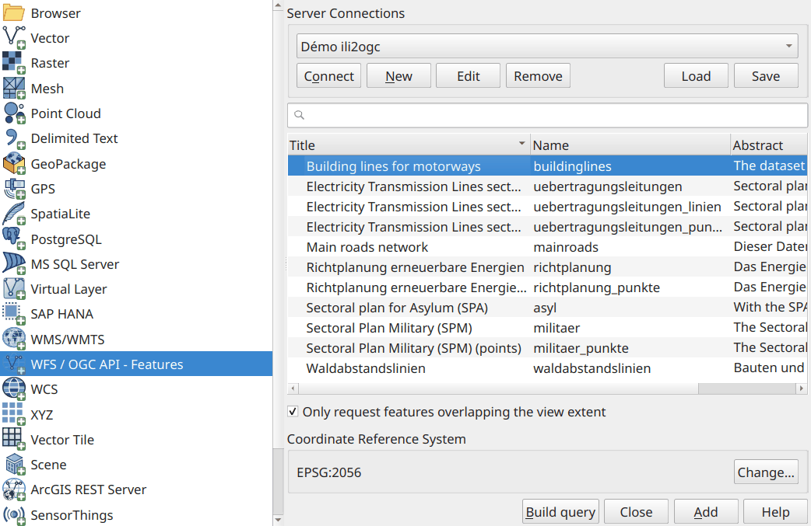
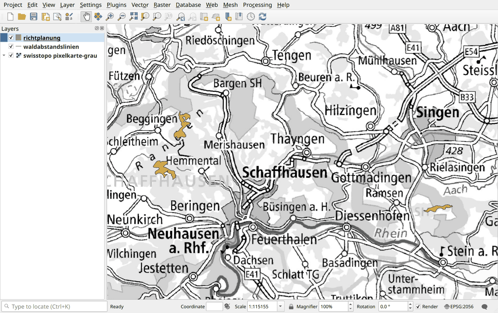

# QGIS pas à pas

Les chemins de menu suivent la documentation de QGIS 3.44 ([docs.qgis.org](https://docs.qgis.org/3.44/fr/docs/user_manual/working_with_ogc/ogc_client_support.html)). Les libellés exacts peuvent varier légèrement selon la langue et la version installée.

Avant de commencer : la pile est démarrée ([Démarrer](demarrer.md)) et le projet QGIS est en EPSG:2056 (barre d'état, en bas à droite).

## 1. Connecter la démo en OGC API - Features

1. Menu **Couche > Ajouter une couche > Ajouter une couche WFS / OGC API - Features** (raccourci : gestionnaire de sources de données, `Ctrl+L`, onglet **WFS / OGC API - Features**).
2. **Nouveau** ouvre la boîte « Créer une nouvelle connexion WFS ».
3. Nom : `Démo ili2ogc`. URL : `http://localhost:5000` (pour OGC API - Features, l'URL à fournir est la page d'accueil du service).
4. Dans les options WFS, laisser la version sur détection automatique (bouton **Détecter**) ; activer la pagination et fixer la taille de page (par exemple 100).
5. **OK**, puis **Connecter** : la liste des collections apparaît.
6. Sélectionner `waldabstandslinien` (et, au choix, `richtplanung`), puis **Ajouter**.

<figure markdown>
  { width="700" }
  <figcaption>QGIS 3.44 : connexion à la démo et liste de ses collections (capture de l'interface, QGIS en anglais).</figcaption>
</figure>

Les attributs de la couche sont ceux décrits au chapitre [Explorer](explorer.md) (`typ_code`, `rechtsstatus`, ...). La carte OGC API - Maps (`/map`) n'est pas chargeable ainsi : la documentation de QGIS 3.44 ne mentionne pas OGC API - Maps, seulement OGC API - Features. Pour voir le style INTERLIS, ouvrir l'adresse `/collections/{id}/map` dans un navigateur.

## 2. Ajouter les fonds et services de swisstopo

### WMTS : fonds de carte

1. Menu **Couche > Ajouter une couche > Ajouter une couche WMS/WMTS**.
2. Onglet **Couches**, **Nouveau**.
3. Nom : `swisstopo WMTS LV95`. URL : `https://wmts.geo.admin.ch/EPSG/2056/1.0.0/WMTSCapabilities.xml`.
4. **OK**, **Connecter**, choisir par exemple `ch.swisstopo.pixelkarte-grau`, **Ajouter**.

Le service est public, sans clé. Le fichier de capacités existe aussi pour EPSG:3857 (`https://wmts.geo.admin.ch/EPSG/3857/1.0.0/WMTSCapabilities.xml`). Les couches thématiques comme `ch.bfe.sachplan-uebertragungsleitungen_kraft` ne figurent pas dans ce WMTS : elles sont dans le WMS.

### WMS : couches thématiques

1. Même boîte, **Nouveau**.
2. Nom : `geo.admin.ch WMS`. URL : `https://wms.geo.admin.ch/` (sans `request=GetCapabilities`).
3. **Connecter**, chercher `ch.bfe.sachplan-uebertragungsleitungen_kraft` (plan sectoriel des lignes de transport d'électricité, OFEN), **Ajouter**.

Service public, sans clé. Autres couches utiles pour la comparaison : `ch.astra.hauptstrassennetz` (routes principales, à rapprocher de `mainroads`) et `ch.astra.baulinien-nationalstrassen` (alignements de construction, à rapprocher de `buildinglines`).

La liste des couches est longue : le champ de recherche de la boîte filtre sur le nom.

## 3. Ajouter geodienste.ch

geodienste.ch publie les géodonnées de base des cantons sous forme harmonisée. Les adresses ont la forme `https://geodienste.ch/db/{thème}/{langue}` (langue : `deu`, `fra`, `ita`).

| Thème | Thème geodienste.ch | Couches |
|---|---|---|
| Distances par rapport à la forêt | `npl_waldabstandslinien` | `waldabstandslinien` |
| Plans directeurs, énergies renouvelables | `richtplanung_erneuerbare_energien` | `windenergie_flaechen`, `solarenergie_punkte`, ... |

### WMS

Connexion WMS/WMTS (même boîte que ci-dessus) :

- `https://geodienste.ch/db/npl_waldabstandslinien/deu`
- `https://geodienste.ch/db/richtplanung_erneuerbare_energien/deu`

Capacités, pour vérification : [Waldabstandslinien](https://geodienste.ch/db/npl_waldabstandslinien/deu?SERVICE=WMS&VERSION=1.3.0&REQUEST=GetCapabilities), [Richtplanung](https://geodienste.ch/db/richtplanung_erneuerbare_energien/deu?SERVICE=WMS&VERSION=1.3.0&REQUEST=GetCapabilities).

### WFS

Connexion WFS (onglet **WFS / OGC API - Features**), version 2.0.0 :

- `https://geodienste.ch/db/npl_waldabstandslinien/deu`
- `https://geodienste.ch/db/richtplanung_erneuerbare_energien/deu`

Types d'objets : `waldabstandslinien` ; `windenergie_flaechen`, `wasserkraft_linien`, etc. (un type par forme d'énergie et par géométrie, plus des types `*_metadaten`). Capacités : [Waldabstandslinien](https://geodienste.ch/db/npl_waldabstandslinien/deu?SERVICE=WFS&VERSION=2.0.0&REQUEST=GetCapabilities), [Richtplanung](https://geodienste.ch/db/richtplanung_erneuerbare_energien/deu?SERVICE=WFS&VERSION=2.0.0&REQUEST=GetCapabilities). Formats de sortie : GML 3.2, GML 3.1.1, GML 2.1.2 et GeoJSON.

### OGC API - Features

Les mêmes thèmes sont aussi publiés en OGC API - Features. Connexion WFS / OGC API - Features, URL de la page d'accueil :

- `https://geodienste.ch/db/npl_waldabstandslinien/deu/ogcapi`
- `https://geodienste.ch/db/richtplanung_erneuerbare_energien/deu/ogcapi`

Liste des collections : [Waldabstandslinien](https://geodienste.ch/db/npl_waldabstandslinien/deu/ogcapi/collections?f=json), [Richtplanung](https://geodienste.ch/db/richtplanung_erneuerbare_energien/deu/ogcapi/collections?f=json).

!!! note "Paramètre `crs` obligatoire"
    Ce service refuse les requêtes sur `/items` qui ne contiennent pas `crs=http://www.opengis.net/def/crs/EPSG/0/2056` (réponse 403). Exemple valide : [`.../collections/waldabstandslinien/items?f=json&limit=1&crs=http://www.opengis.net/def/crs/EPSG/0/2056`](https://geodienste.ch/db/npl_waldabstandslinien/deu/ogcapi/collections/waldabstandslinien/items?f=json&limit=1&crs=http://www.opengis.net/def/crs/EPSG/0/2056). Si la connexion QGIS échoue au chargement des objets, utiliser le WFS.

### Accès et conditions

Les capacités, la liste des collections et les objets répondent sans clé ni authentification. Les capacités des services rappellent que l'utilisation est soumise aux [conditions d'utilisation de geodienste.ch](https://geodienste.ch/terms-of-use) et que des frais peuvent être perçus par les cantons pour l'obtention des géodonnées.

## 4. Une OGC API - Features publique cantonale

Le canton de Bâle-Ville publie ses géodonnées en OGC API - Features, sans clé :

- URL de connexion : `https://api.geo.bs.ch/ogc/v1/wfs3`
- Collections : <https://api.geo.bs.ch/ogc/v1/wfs3/collections>

Les collections sont nombreuses (plusieurs centaines) : charger celle dont le nom contient `baulinie`, par exemple `ch.bs.bau_strassenlinien_basel_stadt_bwba.baulinien.baulinie`, pour la comparer aux alignements de construction.

## Résultat attendu

La carte contient la démo (objets en OGC API), les fonds swisstopo, la couche officielle de l'OFEN et les couches geodienste.ch. L'étape suivante est décrite au chapitre [Comparer](comparer.md).

<figure markdown>
  { width="800" }
  <figcaption>QGIS 3.44 : `richtplanung` (OGC API - Features) sur le fond gris de swisstopo (capture de l'interface ; `waldabstandslinien` est chargée mais hors de l'emprise affichée).</figcaption>
</figure>

